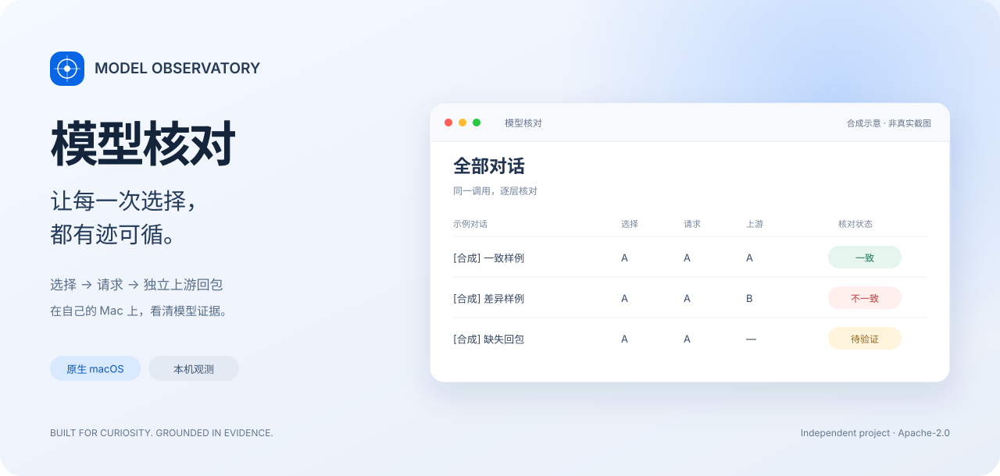
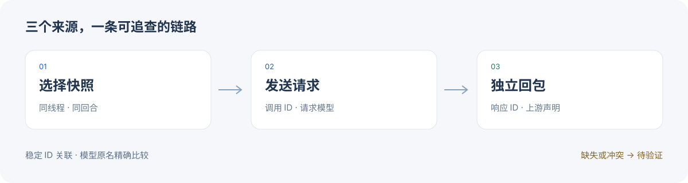

<p align="center">
  
</p>

<h1 align="center">模型核对 · Model Observatory</h1>

<p align="center">一个个人维护的 macOS 小工具，沿着「选择 → 请求 → 上游」追查模型证据。</p>

<p align="center">
  
  
  <a href="LICENSE"></a>
  <a href="https://github.com/KK-Skyline/model-observatory-public/actions/workflows/ci.yml"></a>
</p>

<p align="center">
  <a href="#环境与启动">开始使用</a> ·
  <a href="docs/AGENT_STORAGE_MAINTENANCE.md">存储维护</a> ·
  <a href="#agent-adaptation">复制 Agent 适配提示词</a> ·
  <a href="https://github.com/KK-Skyline/model-observatory-public/issues">反馈问题</a>
</p>

<a id="agent-adaptation"></a>

## 用其他 Harness 或模型？复制这段给 Agent

**先下载本仓库，在仓库目录启动你自己的 Agent，再复制下面整段。** 不必先弄懂内部代码，也不必先把所有空项填完；Agent 应先只读识别环境，只有关键证据无法确认时才提问。

这里的 **Harness** 指你运行模型的客户端或执行框架，例如其他 CLI、IDE 插件或 Agent 框架；**模型/服务商**是另一层。两者都可能需要适配。以下是开发入口，**不是“已支持所有来源”的声明**；当前原生应用仍只支持 macOS，Windows/Linux 需要另做运行平台适配。

```text
你正在我下载的 Model Observatory（模型核对）仓库内工作。
请为我的实际 Harness、模型服务和操作系统完成最小可用适配，不要只给建议或计划。

我的环境（可留空，先从当前仓库及我指定的本机位置只读识别）：
- Harness / 客户端 / 框架及版本：
- 模型服务商 / API协议 / 模型名称（可能多个）：
- 操作系统与可获得的日志或事件来源：

【先识别，再开工】
1. 阅读 AGENTS.md、README.md、docs/SOURCE_ADAPTER_GUIDE.md，以及 Scanner、
   来源解析器、collector 和相关测试。确认当前仓库位置，不要全盘扫描。
2. 区分客户端适配、协议适配、模型证据字段适配和运行平台适配；
   不要把换模型名或改一个base URL当作全部适配完成。
3. 先只读梳理我的来源：逐回合选择、实际请求、终态、独立回包model字段、
   thread/turn/call/response稳定ID；给出映射表、缺失项与来源位置。
   已能确认的信息不反复问；确实缺少schema时，只索取脱敏结构样本。
4. 写下最小方案后继续实现适配器、合成fixture和启动文档；
   若只缺某项证据，先完成不依赖它的部分，不要虚构该项能力。

【实现边界】
5. 优先增加只读来源适配器及明确的数据源选择入口；多来源ID必须加命名空间。
   复用现有前端和记录合同，保留Codex兼容、取消可逆筛选与模型比较规则。
   当前没有通用插件注册API：按真实代码落地，不要假定已有适配接口。
6. 保留模型原名精确比较。只有稳定ID能唯一关联、响应完整、独立model字段
   不冲突时才核验；不得复制请求model作为上游证据，不按时间邻近猜配。
   缺选择、缺回包、无法关联或协议不提供字段时，如实显示待验证及原因。
   服务端model声明不证明内部权重；不要为了“全验证”自动合并模型别名。
7. 坏行、字段缺失、关联冲突和跳过记录必须计数并报告；不吞异常或静默补值。
   先隔离验证一个来源，再考虑多来源同时展示，避免某来源未知拖累所有记录。
8. Windows/Linux适配需单独处理窗口、路径、服务启停和存储维护；
   不声称AppKit、LaunchAgent或APFS压缩在其他平台可直接运行。
   新来源没有自己的完成证明前，不套用Codex快照压缩或删除历史。

【隐私与授权】
9. 只在当前仓库改动，不覆盖别人的未提交修改；原始数据库只读。
   不索要或上传token、auth.json、真实正文、截图、完整日志或授权链接。
   不改系统代理/DNS/证书、全局设置或客户端路由，不重放请求。
   需要安装工具、启用采集、修改客户端配置或发外部模型探针时，
   先准备具体方案，再按本机规则向我确认；不能用提示词绕过授权。

【验证与交付】
10. 使用合成数据验证：一致、不一致、缺选择、缺独立model、重复ID、
    跨来源ID碰撞、乱序、重试、历史切模、坏记录计数、取消无响应、
    部分响应、超时、断连、归属冲突，以及前端筛选与壁纸不受影响。
    在支持的环境运行 python3 -m unittest discover -v，保留现有回归测试。
    不支持的平台先说明限制，再补适当测试；不得删除、跳过或放宽失败项来变绿。
11. 用独立本地合成回包验证真实文件解析和HTTP链路，不冒充实机上游结果。
    有子智能体能力时做独立审查；没有就如实标记未独立审查。
12. 最终给出：修改文件、可用命令、已实测的Harness/协议/模型范围、
    测试结果、仍待验证的证据和回退方式。保持本机数据不进入提交或发行包；
    未经授权不commit、push或发布。不要把“代码写完”称为“真实环境已验收”。
```

[查看技术映射与接入边界](docs/SOURCE_ADAPTER_GUIDE.md) · [给 Agent 的存储维护提示词](docs/AGENT_STORAGE_MAINTENANCE.md)

## 为什么做这个

选了一个模型，也想知道请求实际发给了谁、上游又声明了什么。这个项目把三段来源放在同一个窗口里，方便沿着记录追查，而不是凭当前设置猜历史。

AppKit 原生窗口承载 WebKit 界面，红黄绿按钮可以实际控制窗口；Python 标准库后端只向界面输出必要元数据。记录留在自己的 Mac 上，缺证据时就如实显示待验证。

> **上方为合成界面插画，不是真实用户截图。** A / B 为示例模型名，图中的一致、不一致和待验证不代表实测覆盖率。

## 一眼看清的能力

| | 可以做什么 |
| --- | --- |
| **追查来源** | 按对话最近一轮查看选择、发送模型与独立回包，保留推理和重试详情。 |
| **核对证据** | 同线程/回合选择快照与稳定 ID 关联，模型原名精确比较。 |
| **解释未知** | 待验证、不一致、超时和读取异常分别呈现；项目归属保留冲突候选。 |
| **减少噪声** | 取消且无响应的记录可默认忽略、恢复查看；排除明确子智能体和内部标题任务。 |
| **照顾存储** | 可选无损压缩已完成快照，保留原路径与普通 JSON 读取。 |

<p align="center"></p>

> **证据的边界**：不能承诺全部验证。未保存的上游字段、未完成请求、缺选择或关联冲突仍待验证；超过 24 小时按既有规则只供历史追查。上游 model 声明不证明内部权重。

## 环境与启动

macOS 12+、Python 3.9–3.12、Xcode Command Line Tools。Python 3.13移除了本项目当前使用的imghdr，暂不支持。无需npm、Electron或API key。

先在克隆目录根运行合成测试，不会发模型请求：

```sh
python3 -m unittest discover -v
```

构建本机原生App（会写入你自己的 `~/Applications/模型核对.app`，只允许覆盖相同bundle ID）：

```sh
zsh model_monitor/native/build.command
open "$HOME/Applications/模型核对.app"
```

构建时记录当前项目路径；运行仍依赖源目录，不是独立后端发行包。移动后可在App“文件 → 选择项目文件夹”重新选择。仅运行网页兼容面板可用 `python3 -m model_monitor.open_panel`，会启动或复用本机18083服务并打开浏览器；只启动服务可用 `python3 -m model_monitor.app --no-open`。原生App复用18085。

## 数据与可选采集

需要本机已有Codex SQLite会话数据及原生trace，默认读取用户home下的对应目录；SQLite只读。Codex版本和原生trace schema变化可能造成不兼容。没有现成trace时不能仅凭安装本工具就取得历史上游证据。

原生记录往往只存请求模型，独立上游观测是可选步骤。`python3 -m model_monitor.capture_control enable` **会修改你的Codex路由配置并安装用户级LaunchAgent**；请先审阅 `capture_control.py`，仅在确认本机环境适配后手动执行。回退为 `python3 -m model_monitor.capture_control rollback`。不改系统代理、DNS或证书；采集器沿用已配置的代理。建连预算30秒、上游空闲预算300秒；发送后的请求不会自动重放。

设置、壁纸和授权文件在各自data目录，采集元数据在本机用户目录。文件保留必要稳定ID/路径，仍应视作私有数据，不能连同故障报告上传。仓库不包含真实对话、trace、凭据或私人运行态。

无损压缩默认仅预演：`python3 -m model_monitor.storage_maintenance`。`--apply`会实际压缩满足安全条件的已完成快照；不会自动安装定时任务，调度由使用者自行决定。

## 授权与贡献

贡献者见 [CONTRIBUTORS.md](CONTRIBUTORS.md)，包含 Codex 的开发协助说明。

下载后可把 [存储维护提示词](docs/AGENT_STORAGE_MAINTENANCE.md) 交给本机 Agent；现有压缩不会删除历史，也不保证容量永不增长。其他客户端/模型来源的扩展边界与 Agent 提示词见 [来源适配指南](docs/SOURCE_ADAPTER_GUIDE.md)：可以开发适配器，目前并非通用导入工具。

本项目原创源代码采用Apache-2.0，见[LICENSE](LICENSE)。第三方图标保留原有ISC及Feather派生MIT声明，见[THIRD_PARTY_NOTICES.md](THIRD_PARTY_NOTICES.md)。报告问题前请阅读[SECURITY.md](SECURITY.md)，只提交脱敏元数据。

---

个人项目，欢迎带着脱敏复现来交流。由 [KK-Skyline](https://github.com/KK-Skyline) 维护，Codex 协助开发与审查；详见 [贡献者](CONTRIBUTORS.md)。品牌图像的 [生成提示词](docs/BRAND_IMAGE_PROMPTS.md) 也一并开放。本项目与 Apple、OpenAI 无隶属或官方背书关系。
